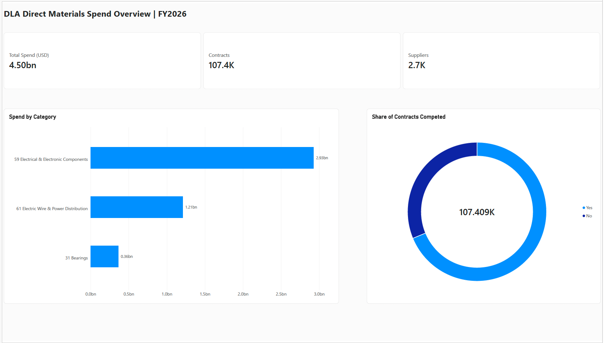
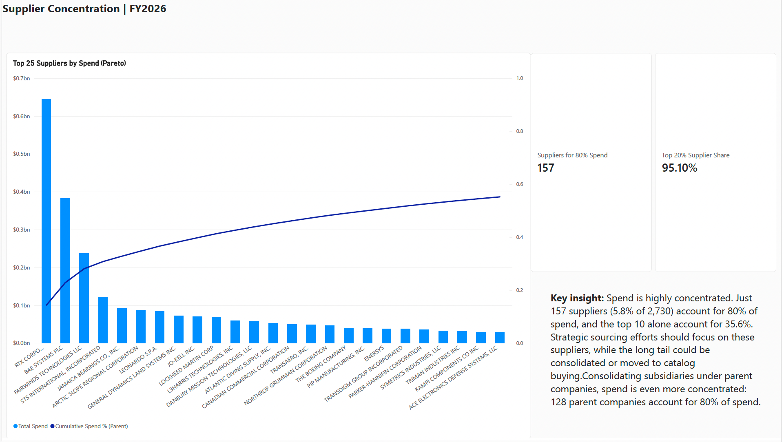
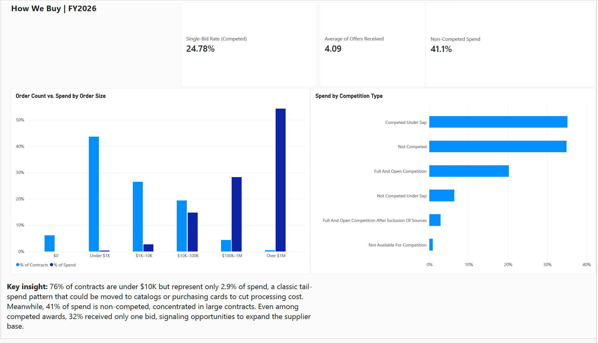
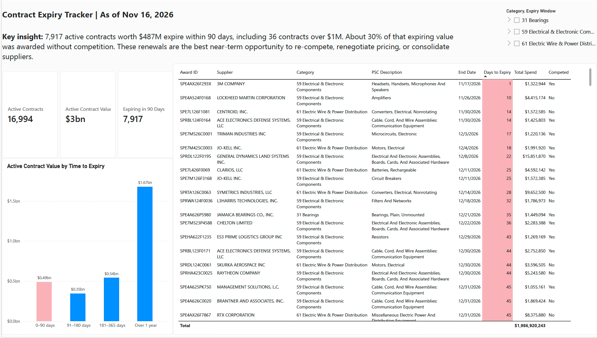

# Procurement Spend Analysis: $4.5B in DLA Direct Materials

A Power BI spend analysis of **107,409 real federal contracts** for industrial direct materials (electronic components, electric wire and power distribution equipment, and bearings) purchased by the U.S. Defense Logistics Agency (DLA).

The report answers four questions a category manager asks first: **where the money goes, who gets it, how it is bought, and which contracts need action next.**



## Key findings

| Metric | Value |
| --- | --- |
| Contracts analyzed | 107,409 |
| Total obligated spend | $4.50B |
| Suppliers | 2,730 |
| Suppliers covering 80% of spend | 157 (5.8%) |
| Top 20% of suppliers' share of spend | 95.1% |
| Spend awarded without competition | 41.1% |
| Contracts under $10K (share of spend) | 76% of contracts (2.9% of spend) |
| Active contract value expiring within 90 days | $487M (7,917 contracts) |

- **Spend is highly concentrated.** 157 suppliers account for 80% of spend. Rolled up to parent companies, just 128 groups cover 80%, and RTX Corporation alone holds 14.3%.
- **Classic tail spend.** Three in four orders are under $10K but carry under 3% of spend, a strong case for catalogs or purchasing cards.
- **Sole-source buying sits in large awards.** 31% of contracts were not competed, but they carry 41% of spend. Even among competed awards, 24.8% received only one bid.
- **A near-term renewal window.** 36 contracts over $1M expire within 90 days, and about 30% of the value expiring in that window was not competed.

## Report pages

| Page | Question | Visuals |
| --- | --- | --- |
| Spend Overview | Where does the money go? | KPI cards, spend by category, competition share |
| Supplier Pareto | Who gets it? | Pareto chart (supplier and parent company), concentration KPIs |
| Buying Channels | How is it bought? | Order count vs. spend by order size, spend by competition type |
| Contract Tracker | What needs action next? | Expiry window chart, RAG-flagged contract table, slicers |

| | |
| --- | --- |
|  |  |
|  | |

## Data

- **Source:** [USAspending.gov](https://www.usaspending.gov/) Advanced Search → Prime Award Summaries (contracts), downloaded Nov 16, 2026
- **Filters:**
  - Time period: FY2026
  - Award type: all contracts
  - Awarding agency: Defense Logistics Agency
  - Product Service Code (PSC) groups: 31 Bearings, 59 Electrical & Electronic Components, 61 Electric Wire & Power Distribution Equipment
- **Why this data:** company purchase-order data is rarely public. DLA buys the same parts industrial manufacturers source every day, so it is a realistic stand-in for a direct materials category.

### Cleaning

The raw export was cleaned in Python (pandas), reducing it from 286 columns (200 MB) to 22 analysis-ready columns (10 MB):

- Selected and renamed the fields needed for analysis (supplier, parent company, PSC, amount, dates, competition, offers, business size, origin)
- Converted dates and tidied text fields
- Added derived fields:

| Field | Logic |
| --- | --- |
| Category | First two digits of PSC code mapped to group name |
| Contract Status | Active if End Date ≥ Nov 16, 2026, else Expired |
| Competed | No if Competition Type starts with "Not Competed", else Yes |
| Order Size Band | $0, Under $1K, $1K–10K, $10K–100K, $100K–1M, Over $1M |
| Award Year | Calendar year of Award Date |

## Data model and DAX

The model is a single `Contracts` table. Key measures and calculated columns:

- **Cumulative Spend %:** ranks suppliers by spend and returns each one's running share of total spend, for the Pareto line
- **Suppliers for 80% Spend** and **Top 20% Supplier Share:** concentration KPIs independent of visual filters on supplier
- **Single-Bid Rate** and **Non-Competed Spend %:** competition health metrics
- **Days to Expiry, Expiry Window, Expiring in 90 Days:** drive the contract tracker and its red/amber/green flags
- **Band Order** and **Window Order:** sort-by columns, computed from the underlying amount or days to avoid circular dependencies

## Recommendations

1. **Re-compete before renewing:** start with non-competed contracts over $1M that expire within 90 days.
2. **Manage strategic suppliers by parent company:** the 128 groups holding 80% of spend are the targets for relationship reviews and volume negotiations.
3. **Automate the tail:** move orders under $10K to catalogs, long-term agreements or purchasing cards.
4. **Widen the supplier base:** use market research where competed awards draw a single bid.

## Limitations

- Amounts are total dollars obligated to date per award, not spend within FY2026 alone.
- The FY2026 filter keeps any award with an action in FY2026, so some long-term contracts date back to 2012.
- Public data has no delivery or quality metrics, so supplier performance is not scored.
- Offers Received is blank for about 45% of awards; bid metrics use only awards that report it.
- PSC group 53 (Hardware & Abrasives) was not included in this export.

## Repository structure

```
procurement-spend-analysis-powerbi/
├── README.md
├── Procurement_Spend_Analysis.pbix   # Power BI report file
├── Procurement_Spend_Analysis.pdf    # all four report pages as PDF
├── 01_spend_overview.png
├── 02_supplier_pareto.png
├── 03_buying_channels.png
└── 04_contract_tracker.png
```

## Tools

Python (pandas) · Power BI (Power BI service, DAX, conditional formatting) · USAspending.gov

## How to view

- **Quick look:** open [`Procurement_Spend_Analysis.pdf`](Procurement_Spend_Analysis.pdf) for all four pages.
- **Interactive:** open [`Procurement_Spend_Analysis.pbix`](Procurement_Spend_Analysis.pbix) in Power BI Desktop to explore filters, slicers and DAX measures.
- **Case study:** https://www.linkedin.com/in/qihong-li-pm/
